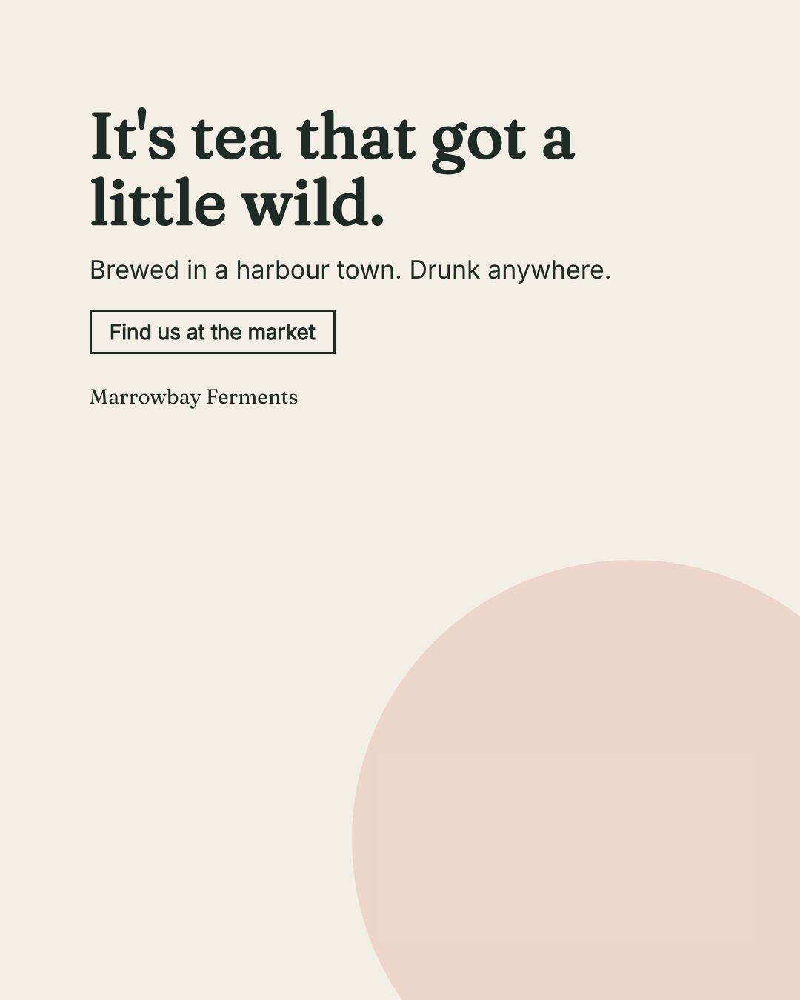

<p align="center">
  <a href="LICENSE"></a>
  
  
</p>

<p align="center"><a href="README.fr.md"><b>Français</b></a></p>

# studio

A Claude Code plugin that makes **an ad in one session**: a poster or a social post for a brand, from ten lines about
the brand to a piece you keep or send back. Every step is a page you look at and decide on.

```
brand (10 lines) → brief → divergence → piece → check → you decide
```

<p align="center"></p>

## Install

```bash
claude plugin marketplace add amiel-35/ix-studio
claude plugin install studio@ix-studio
```

Requirements: Claude Code and Python 3.10+. Optional: Chrome or Chromium (for `piece.png`), an image generator (below).

## Use

In Claude Code, in any folder:

> /studio a poster for Marrowbay Ferments, a small kombucha maker: make city people want to try it

Claude writes the brand lines and the brief with you, opens one page per step and tells you the one question each
page asks. Everything for the piece lives in `poster/`:

| Step | You give or Claude writes | Page | Your call |
|---|---|---|---|
| 1 Brand | `brand.md`: name, colours, fonts, logo, voice, never (from your words, a design-system skill, or a brand dossier) | `1-brand.html` | is it the brand? |
| 2 Brief | `brief.md`: objective, audience, message, format | `2-brief.html` | is it the job? |
| 3 Divergence | `variants/*.json`: blind variants, one per mandate, each with the default it set aside | `3-divergence.html` | pick one |
| 4 Piece | the image (generated, or yours), the headline set in HTML | `4-piece.html`, `piece.png` | |
| 5 Check | palette, type, contrast, banned words, plus a judge's notes that never block | `5-check.html` | keep, or again |

For an ad the unit is the **headline + image** pair: the headline first, the image answers it. The image model never
writes text. The divergence follows the method of
[design-divergent](https://github.com/amiel-35/ix-design-divergent) (mandates that each look somewhere else, blind
variants, the attractor, you choose).

## Images

| Engine | How | When |
|---|---|---|
| your key | `export OPENAI_API_KEY=...` (model: `STUDIO_IMAGE_MODEL`, default `gpt-image-1`) | anywhere |
| your plan | the [Codex CLI](https://github.com/openai/codex), installed and logged in | on your machine; check that your plan's terms allow this use |
| your file | drop `image.png` in the piece folder | always |
| none | nothing to set up | the piece is composed on a flat brand ground, and the page says so |

## Without Claude

Each step is a command; write the input file by hand and run it alone, or replay the whole example:

```bash
python3 scripts/studio status poster        # where you are, and the next command
sh examples/marrowbay/poster/build.sh       # the fictional example, end to end, no generator needed
python3 -m unittest discover -s tests       # tests, including the end-to-end flow
```

## Going further

The rich **brand dossier** (provenance on every value, inference from a site, conflicts, versions) is still here and
optional: skill `brand-dossier`, `python3 scripts/studio brand poster --from-dossier brand` to start a piece from it.
See [the brand dossier](docs/en/brand-dossier.md) and [the architecture](docs/en/architecture.md).

Experimental. MIT, see [LICENSE](LICENSE) and [THIRD_PARTY.md](THIRD_PARTY.md). Marrowbay Ferments is fictional.
