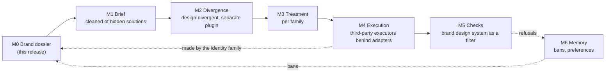
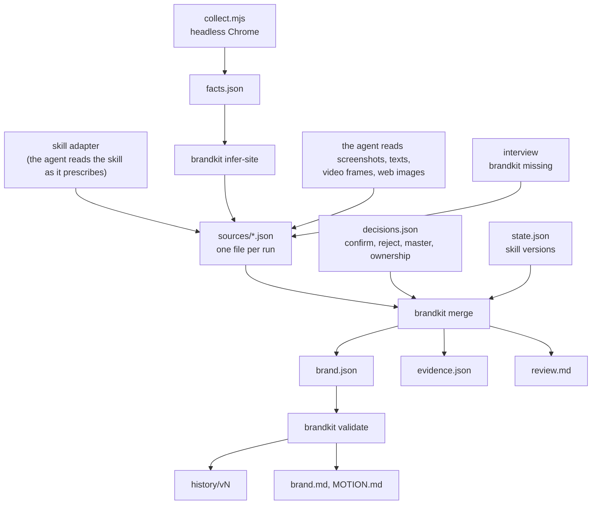

# Architecture

The studio turns a brand and a request into creative pieces (films and motion, still visuals, screens and mock-ups,
visual identity directions) that really diverge before anyone chooses, respect the brand, and are executed by the
tool suited to the form without that tool's own look taking over. The plugin is the means, not the result.

## Modules

| Module | Owns | Status |
|---|---|---|
| M0 Brand dossier | the dossier format, provenance, priority, the three input adapters, the review, versions, exports | available: skill `brand-dossier`, tool `brandkit` |
| M1 Brief | cleaning the request of solutions drawn into it; the project's content and format | planned |
| M2 Divergence | mandates, blind variants, the attractor, the user's pick | [design-divergent](https://github.com/amiel-35/ix-design-divergent), its own repository, referenced |
| M3 Treatment | from a direction to an execution plan, per family | planned |
| M4 Execution | adapters to third-party executors: what each receives (direction + dossier), what is taken away (its own taste lines) | planned |
| M5 Checks | is the piece conformant; the brand's design system used as a filter | planned |
| M6 Memory | bans from refusals, preferences, what was observed, what was verified | planned |

The plugin owns the dossier, the brief, the divergence contract, the checks, the memory and the contracts between
them; treatment and execution are pluggable adapters. A brand without enough material goes through the identity
family first; its frozen output enters the dossier as `created`, validated, which then counts as typed.

## Contracts

**M0 → every module.** A module never opens `brand.json` to pick a value itself. It reads a field with
`brandkit get <brand dir> <path>` and receives:

- `confirmed`: a value, its source; usable anywhere;
- `to_confirm`: a value, its source, its confidence and `use: explore only`; usable for an exploration (a divergence
  variant), and a final piece that uses it says so;
- `ask` or `to_create`: the status alone, exit code 3; the module asks the user or stops. It never fills the gap.

For a list (colours, type, logo), it receives the items of the look it asks for. When there are several looks and
none is the master, a module asks which one applies rather than mixing them.

**M0 → skills that read brand-intake's format.** `brand.md` and `MOTION.md`, regenerated at each validation, with
the same sections and "ASK ME" for gaps.

**M0 → M2.** The confirmed palette, type and logo are hard constraints: the idea diverges, never the palette or the
type of a brand that has a design system.

**M6 → M0.** A refusal becomes a ban in `bans` with the user's words and the date (reserved field in this release).

## Inside M0

Everything mechanical (merge, priority, checks, versions, exports, measurements of colours and cuts) is a script, so
that it gives the same answer twice. Everything that needs judgement (reading a design system as it asks to be
read, describing imagery, a voice, a motion, classing a web image) is done by the agent and written down as a source
file with its evidence, so that a script can check its form and the user can check its substance.

## Dependencies

| Dependency | For | Required |
|---|---|---|
| Python 3.10+ | `brandkit` | yes |
| Node 22+ and an installed Chrome, Chromium, Edge or Brave | `collect.mjs` | for the site inference |
| ffmpeg | frames and cuts of videos, colours of images | for videos and image sampling |
| a browser the session can drive | the web image search | for R8; without it the inference runs on the site and files |
| a design-system skill | sure values | when the brand has one |
