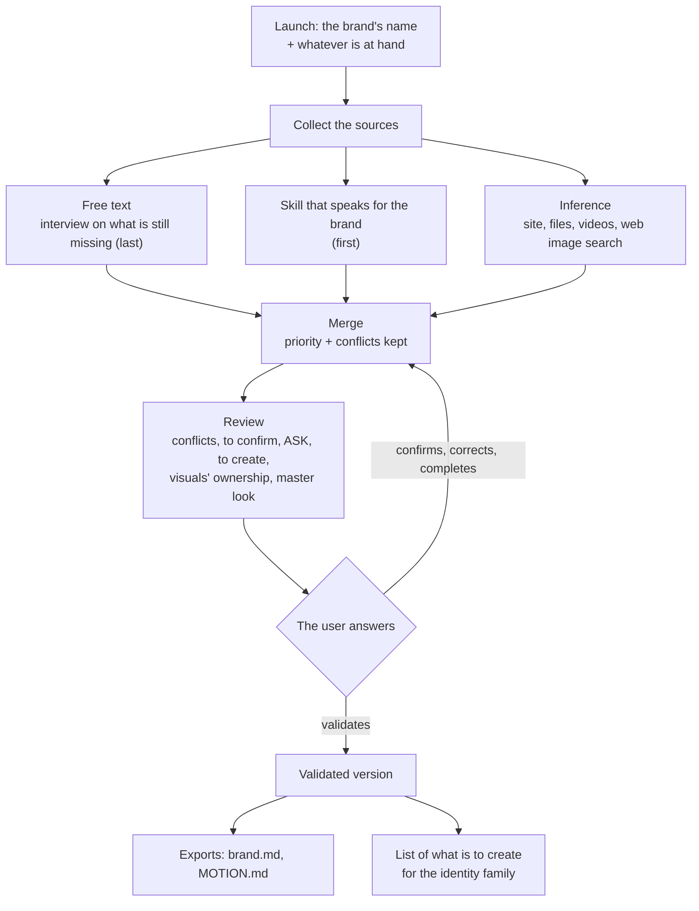
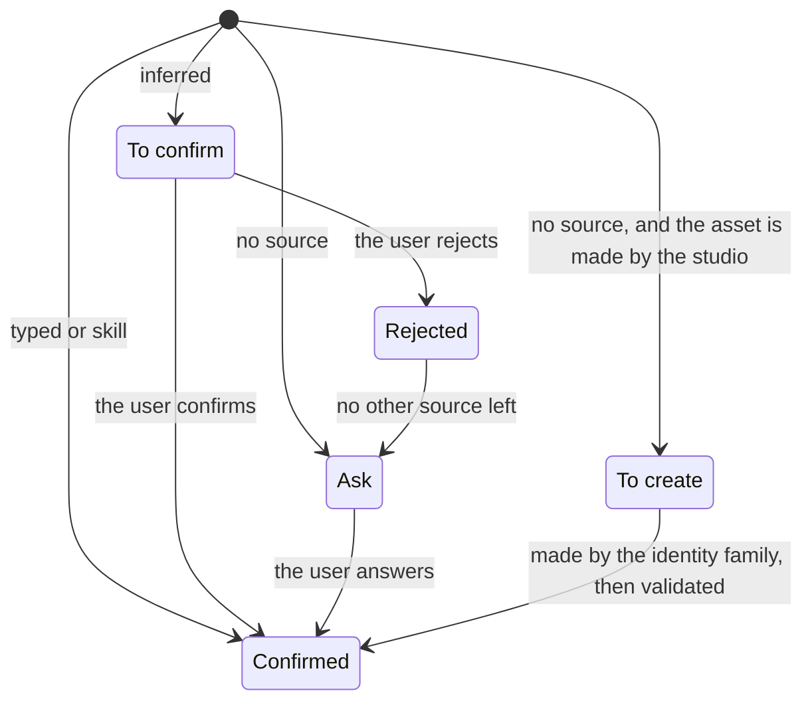

# The brand dossier

Part 1 of the studio. Everything else reads it.

## Goal

Start from a brand you know nothing about and end with a **dossier** every module of the studio can read, where each
value says where it came from and whether it is sure, and where what is missing is written as missing, never
guessed.

## Scope

**In:** the format (below) and its rules; three input adapters (free text, a skill that speaks for the brand,
inference with a web image search); the merge with a fixed priority; the review where the user confirms; numbered
versions; exports for the skills that read the brand-intake format.

**Out:** *creating* a missing asset (the dossier marks it "to create" and lists it for the identity family); the
brand signature (a reserved field); reusing in a deliverable an image found on the web; the brief, the project's
real content and its format, which change with every project and live with the brief, not with the brand.

## Who does what

| Actor | With the dossier |
|---|---|
| The user | starts it, gives sources, answers the ASK lines, confirms or rejects what is inferred, validates a version |
| The brand | provides its material: site, files, design system, texts |
| A skill that speaks for the brand | provides sure values (colours, type, logo of a design system) |
| Downstream modules (brief, divergence, checks, executors) | read it; receive a value with its status, never an invented one |
| Skills that read the brand-intake format | read the exports `brand.md` and `MOTION.md` |

## Flow



1. **Launch.** The brand's name and what the user has: a site, folders, files, a skill's name, a text. Only the name
   is required.
2. **Collect.** The skill runs first (it saves useless inferences), the inference next, the free text last, to fill
   the gaps.
3. **Merge.** For each field, the priority picks the value kept; the other values stay visible as discarded, with
   their source.
4. **Review.** One message, grouped by asset. For an ASK line the closest thing found may be shown, marked as such;
   it is never filled in.
5. **Validate.** A numbered version. A dossier can be validated with ASK lines left: they stay missing downstream.
6. **Export.** `brand.md` and `MOTION.md` are regenerated from the dossier, never edited by hand.

**Updating.** A new source (a file, a refusal, a design system that changed) re-runs what it touches, then merge,
review, new version. Old versions stay readable in `history/`.

**Reading from a module.** A module asks for a field; it receives the value, its status and its provenance. For an
ASK or to-create field it receives the status only, and it is up to the module to ask or to stop.

## Rules

| | Rule |
|---|---|
| R1 | **Provenance everywhere.** Each value carries its source type (typed, skill, inferred, created), its precise origin (skill and version, page and date, file), its date, and for an inferred value, its evidence and a confidence (high, medium, low). |
| R2 | **Statuses:** confirmed, to confirm, ask, to create, rejected (see the cycle below). |
| R3 | **Priority:** skill, then typed, then inferred. A created value, once validated, counts as typed. Inside inferred: declared in a source file *and* painted on visible elements > read on the rendered page > sampled from an image > taken from an image found on the web. A value declared but not used does not count: a site built on a template declares the template's colours and fonts, not the brand's. |
| R4 | **Conflicts are kept.** The priority picks, the conflict is shown at the review. A disagreement between the skill and the user is not settled in the dossier: the skill wins; to change the value, change the design system. |
| R5 | **Nothing guessed.** A field with no source stays ASK (or to create). No default, no palette "for now". |
| R6 | **Inferred is not confirmed** until the user says so. A downstream module may use it to explore, never for a final deliverable without saying so. |
| R7 | **The inference covers everything**: colours with their role, type, logo, imagery, voice, motion, bans. What is read badly (a voice from three texts, a ban deduced from an absence) comes out with a low confidence. |
| R8 | **Web images.** The inference may search the web for the brand's visuals. Each image is classed: official (the brand's domain or account), official relayed (a press article naming the brand and its agency), probable, uncertain. The domain alone does not decide. Only the first three feed the inference. Address and date are kept, never the file. The user confirms or corrects every class at the review; a correction removes what rested only on that image. |
| R9 | **The logo is a file.** Never redrawn. A favicon or a blurry PNG is kept with its nature, and the vector logo becomes ASK. |
| R10 | **Several looks are named, never averaged** (a site, an older identity, a campaign). The user picks the master look. |
| R11 | **Bans learned** from the user's refusals have a reserved field (word for word, with the date), filled by the memory module. |
| R12 | **Versions.** Each validation creates a version. Values from a skill record its version; if the skill changed, they come back "to confirm". |
| R13 | **Exports** in the brand-intake format (same sections), "ASK ME" for what is missing. The studio never writes a rule into the project's `CLAUDE.md` without asking. |
| R14 | **Public and private.** The published plugin holds no dossier of a real brand: the example is fictional. |



## Adapters

| Adapter | Input | Output | Does not |
|---|---|---|---|
| **Free text** | answers to a short interview, or a pasted text | typed values, confirmed | rephrase the user's words for the promise |
| **Skill that speaks for the brand** | the name of a design-system skill | the values it covers, confirmed, with its version | read the skill's files behind its back: it follows the reading method the skill prescribes |
| **Inference** | site addresses, folders, files, videos, a web image search | inferred values, to confirm, each with evidence and a confidence, and the list of what was not found | fill a gap, or keep an image found on the web |

The inference works in four steps: **collect** the site (screenshots, logo candidates, colours really painted
weighted by surface, typefaces weighted by text and checked against what the browser rendered, CSS variables), the
collector being adapted from `om grab` in [huashu-motion](https://github.com/alchaincyf/huashu-motion) (MIT);
**search** the web for visuals and class them; **analyse** (palette and roles, imagery, voice from the texts, motion
from frames extracted at each cut of a video, bans in low confidence); **return** values with evidence, and what is
missing.

The interview reuses the two batches of brand-intake (who, for whom, what, which feeling; then colours, type, logo,
references, one ban) and asks only what the other two adapters left missing.

## Where it lives

In the brand's project, a `brand/` folder:

| File | Role |
|---|---|
| `brand.json` | the dossier itself, the only source |
| `brand.md`, `MOTION.md` | generated exports, not to be edited |
| `review.md` | the latest review |
| `evidence.json` | every source consulted: address, date, file, ownership |
| `history/vN/` | validated versions |
| `sources/` | one file per adapter run (internal) |
| `decisions.json` | what the user confirmed, rejected, chose (internal) |
| `state.json` | settings, last known version of each skill (internal) |
| `collect/` | material collected from the brand's own site and files, never images found on the web |

Why a JSON plus exports rather than a Markdown file alone: provenance per value and the automatic checks of later
parts (comparing an output's colours to the tokens) need a format a script can read; the `.md` exports keep
compatibility with the skills that already read brand-intake's files.

## Data model

Keys in English; values in the brand's language.

### A value

```json
{
  "value": "#1F3A5F",
  "status": "confirmed | to_confirm | ask | to_create | rejected",
  "source": {"type": "typed | skill | inferred | created | none", "origin": "acme-ds@2.3.0", "at": "2026-10-23"},
  "confidence": "high | medium | low",
  "evidence": ["ev-1a2b3c4d"],
  "discarded": [{"value": "#203B60", "source": {"type": "inferred", "origin": "https://acme.example (2026-10-23)", "at": "2026-10-23"}, "status": "overridden", "conflict": true}],
  "closest": [{"value": "...", "note": "closest thing found, not filled in"}]
}
```

`confidence` and `evidence` exist only for an inferred value. `discarded` keeps what the priority set aside (R4) or
the user rejected. A missing value has `value: null`, the status `ask` or `to_create`, and a source of type `none`
that says who looked. An inferred value the user confirmed carries `confirmed: {by, at}`.

### Sections

| Section | Fields | Note |
|---|---|---|
| `identity` | `name`, `one_liner`, `offer`, `links` | `name` is the only field required at launch |
| `audience` | `who`, `situation` | |
| `promise` | `tagline`, `signature_line`, `key_messages` | exact words, never rephrased |
| `voice` | `register`, `address`, `traits`, `banned_words`, `samples` | |
| `colours` | items: `hex`, `role`, `share`, `name` | per look |
| `typography` | items: `family`, `role`, `files`, `licence`, `sizes`, `weights` | licence often ASK |
| `logo` | items: `file`, `format`, `variant`, `background`; `gaps` | never redrawn (R9) |
| `imagery` | `style`, `do`, `dont` | |
| `motion` | `entrances`, `holds`, `exits`, `easing`, `tempo`, `never`, `frame_rate`, `texture`, `example` | the last three were added to fill every section of `MOTION.md` |
| `bans` | items: `rule`, `origin` | reserved, filled by the memory module (R11) |
| `references` | items: `url`, `grammar` (what is taken from it) | never a model to copy |
| `looks` | items: `id`, `name`, `kind`, `summary`, `evidence`, `master` | when several looks coexist (R10) |
| `signature` | reserved | out of scope |
| `meta` | `version`, `validated_at`, `draft`, `language`, `to_create`, `sources` | `to_create` feeds the identity family |

A list section holds `items`; every field of an item is a value as above. An item belongs to a look (`brand` by
default). The highest source tier that gives items for a look wins the whole look (a design system's palette is not
completed by colours sampled elsewhere); lower items go to the section's `discarded`.

### A piece of evidence (`evidence.json`)

| Field | Content |
|---|---|
| `id` | the id values cite (derived from kind and address) |
| `kind` | page, file, web_image, video, skill, text |
| `where` | address or path |
| `at` | date consulted |
| `ownership` | official, official_relayed, probable, uncertain (R8), with `ownership_proposed` and `ownership_status` (to_confirm, confirmed, corrected) |
| `kept` | always false for a web image |

## Edge cases

| Case | Expected |
|---|---|
| The brand has nothing: no site, no file, no skill | interview only; what is missing is ASK or to create; the to-create list is returned |
| Two sources disagree | the priority picks, the conflict is shown |
| The user contradicts the design system | the design system wins; the review says so; change the design system to change the value |
| The skill is unavailable or its version changed | its values come back to confirm, the review says why |
| The site shows several looks | the looks are named, the master is asked |
| An image found on the web may not be the brand's (a fan, a competitor, an old campaign) | classed uncertain, does not feed |
| An official campaign relayed by the press | ownership "official relayed"; its look is a campaign look, never the master without the user's word; it mostly feeds the voice |
| The site declares a template's colours and fonts | what is declared but not visible is set aside; what is painted on headings, buttons, logo is kept; a colour declared only under a UI kit's names, or a template's default font, comes out with a low confidence |
| Only a favicon or a blurry PNG as logo | kept with its nature, vector logo ASK |
| Proprietary typeface | family noted, files and licence ASK |
| A colour sampled on an image differs from the CSS | the CSS wins, the sample is discarded |
| A voice read on three texts | low confidence, to confirm |
| A cookie banner covers the site | the collector refuses it when it offers a refusal, never accepts |
| Site unreachable, blocked, or all JavaScript | the review says so; nothing is invented to make up for it |
| A downstream module reads an ASK field | it receives the status, not a value |

## Acceptance criteria

| # | Given | When | Then |
|---|---|---|---|
| C1 | a validated dossier | its values are walked | each has a status and a complete source (type, origin, date) |
| C2 | a validated dossier | a value without an origin is looked for | there is none |
| C3 | a design-system value and an inferred value differ for the same field | the merge runs | the design system's value is kept, the other is in `discarded` |
| C4 | an inferred value | the user did nothing | its status is "to confirm", never "confirmed" |
| C5 | a field with no source | the dossier is built | it is ASK or to create, without a value |
| C6 | a brand with a design-system skill | the dossier is built | colours and type are the design system's, identical (hex and families compared), source "skill" with its version |
| C7 | a brand with only a site | the dossier is built | colours, type and logo are inferred with evidence; voice, motion and bans are to confirm or ASK; the review lists everything missing |
| C8 | a web image search | it ran | each image consulted is in `evidence.json` with its address, date and ownership, and no file is kept |
| C9 | a validated dossier | the exports are generated | `brand.md` and `MOTION.md` have brand-intake's sections, and every gap reads "ASK ME" |
| C10 | the public repository | it is walked | it holds no dossier of a real brand, only the fictional example |
| C11 | a validated dossier with ASK fields | a downstream module reads one | it receives the status, not a value |
| C12 | the project's `CLAUDE.md` | a dossier is built | it is not modified without the user's consent |
| C13 | a brand whose identity changed | the image search brings back the old and the new logo | both looks are named separately, the master is asked, nothing is averaged |

`tests/test_brandkit.py` checks C1 to C5, C8, C9, C11, C12, R8, R10 and R12 on the fictional example;
`scripts/check_public.py` checks C10.
