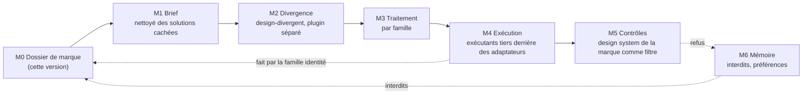
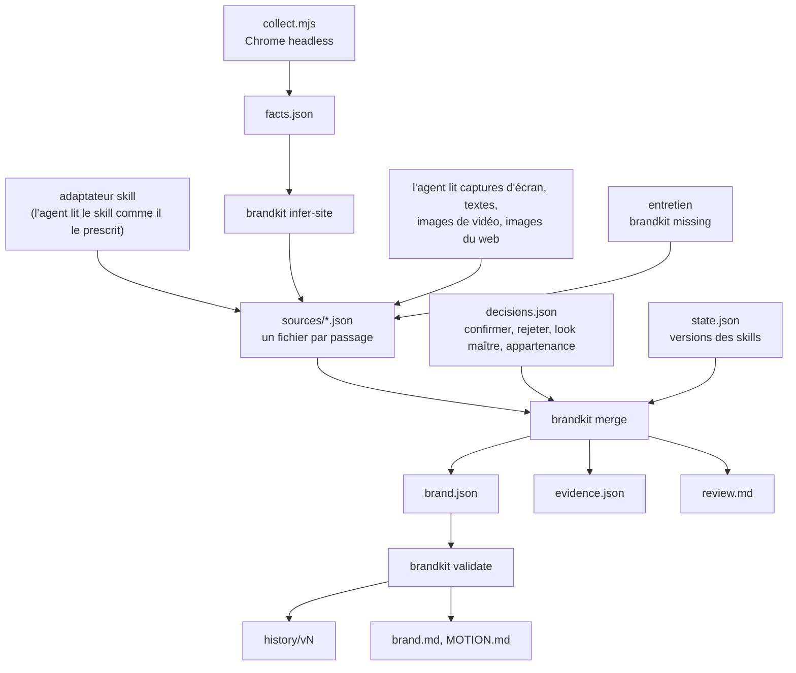

# Architecture

Le studio transforme une marque et une demande en pièces créatives (films et motion, visuels fixes, écrans et
maquettes, pistes d'identité visuelle) qui divergent vraiment avant que quiconque choisisse, respectent la marque, et
sont exécutées par l'outil adapté à la forme sans que le style propre de cet outil prenne le dessus. Le plugin est le
moyen, pas le résultat.

## Modules

| Module | Possède | Statut |
|---|---|---|
| M0 Dossier de marque | le format du dossier, la provenance, la priorité, les trois adaptateurs d'entrée, la revue, les versions, les exports | disponible : skill `brand-dossier`, outil `brandkit` |
| M1 Brief | nettoyer la demande des solutions qui s'y sont glissées ; le contenu et le format du projet | prévu |
| M2 Divergence | mandats, variantes en aveugle, l'attracteur, le choix de l'utilisateur | [design-divergent](https://github.com/amiel-35/ix-design-divergent), son propre dépôt, référencé |
| M3 Traitement | de la direction au plan d'exécution, par famille | prévu |
| M4 Exécution | adaptateurs vers des exécutants tiers : ce que chacun reçoit (direction + dossier), ce qu'on lui retire (ses propres lignes de goût) | prévu |
| M5 Contrôles | la pièce est-elle conforme ; le design system de la marque utilisé comme filtre | prévu |
| M6 Mémoire | interdits issus des refus, préférences, ce qui a été observé, ce qui a été vérifié | prévu |

Le plugin possède le dossier, le brief, le contrat de divergence, les contrôles, la mémoire et les contrats entre
eux ; le traitement et l'exécution sont des adaptateurs interchangeables. Une marque sans assez de matière passe
d'abord par la famille identité ; sa sortie figée entre dans le dossier comme `created`, validée, ce qui compte alors
comme saisi.

## Contrats

**M0 → tous les modules.** Un module n'ouvre jamais `brand.json` pour y prendre une valeur lui-même. Il lit un champ
avec `brandkit get <brand dir> <path>` et reçoit :

- `confirmed` : une valeur, sa source ; utilisable partout ;
- `to_confirm` : une valeur, sa source, sa confiance et `use: explore only` ; utilisable pour une exploration (une
  variante de divergence), et une pièce finale qui s'en sert le dit ;
- `ask` ou `to_create` : le statut seul, code de sortie 3 ; le module demande à l'utilisateur ou s'arrête. Il ne
  comble jamais le trou.

Pour une liste (couleurs, typo, logo), il reçoit les éléments du look qu'il demande. Quand il y a plusieurs looks et
qu'aucun n'est le look maître, un module demande lequel s'applique au lieu de les mélanger.

**M0 → skills qui lisent le format de brand-intake.** `brand.md` et `MOTION.md`, régénérés à chaque validation, avec
les mêmes sections et « ASK ME » pour les manques.

**M0 → M2.** La palette, la typo et le logo confirmés sont des contraintes dures : l'idée diverge, jamais la palette
ni la typo d'une marque qui a un design system.

**M6 → M0.** Un refus devient un interdit dans `bans`, avec les mots de l'utilisateur et la date (champ réservé dans
cette version).

## Dans M0

Tout ce qui est mécanique (fusion, priorité, vérifications, versions, exports, mesures de couleurs et de coupes) est
un script, pour qu'il donne la même réponse deux fois. Tout ce qui demande du jugement (lire un design system comme
il demande à être lu, décrire une imagerie, une voix, un motion, classer une image du web) est fait par l'agent et
écrit comme un fichier source avec ses preuves, pour qu'un script puisse en vérifier la forme et que l'utilisateur
puisse en vérifier le fond.

## Dépendances

| Dépendance | Pour | Requise |
|---|---|---|
| Python 3.10+ | `brandkit` | oui |
| Node 22+ et un Chrome, Chromium, Edge ou Brave installé | `collect.mjs` | pour l'inférence depuis un site |
| ffmpeg | images et coupes des vidéos, couleurs des images | pour les vidéos et l'échantillonnage d'images |
| un navigateur que la session peut piloter | la recherche d'images sur le web | pour R8 ; sans lui, l'inférence tourne sur le site et les fichiers |
| un skill de design system | valeurs sûres | quand la marque en a un |
