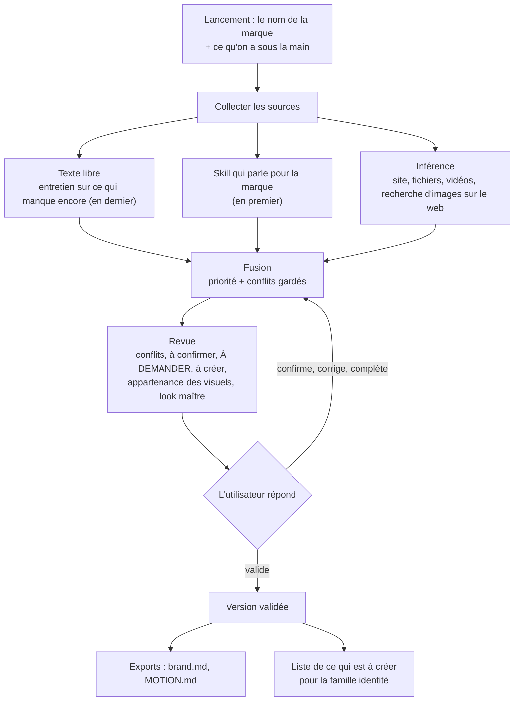
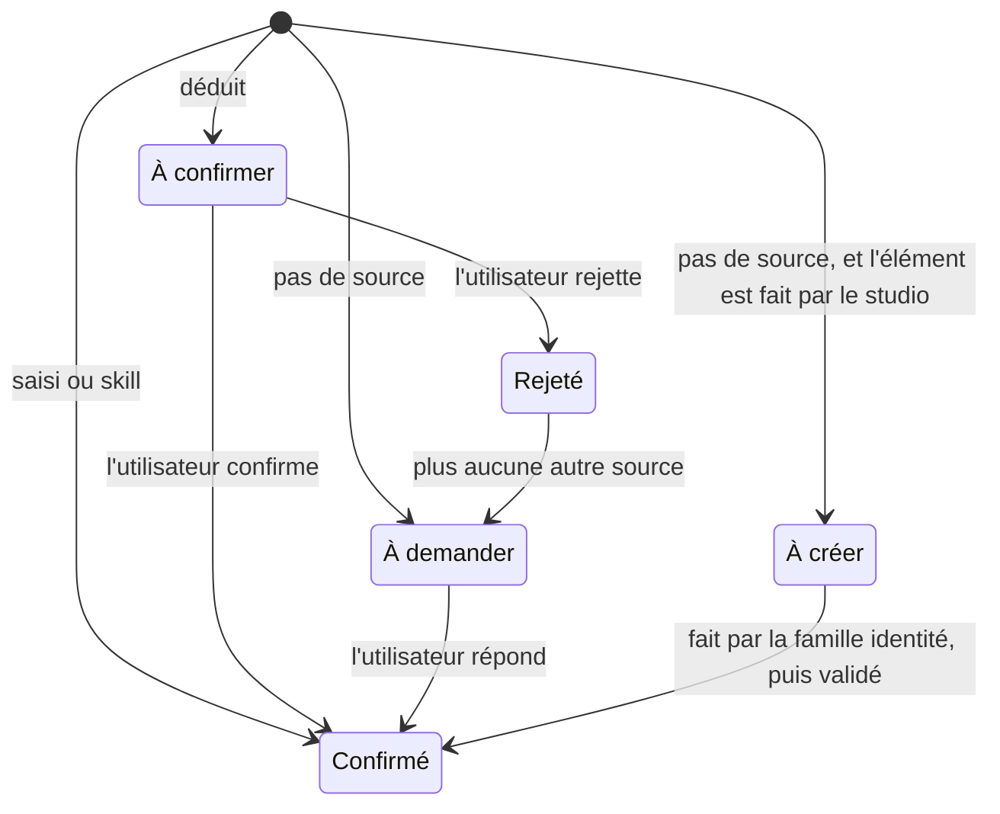

# Le dossier de marque

Partie 1 du studio. Tout le reste le lit.

## Objectif

Partir d'une marque dont tu ne sais rien et finir avec un **dossier** que chaque module du studio peut lire, où
chaque valeur dit d'où elle vient et si elle est sûre, et où ce qui manque est écrit comme manquant, jamais deviné.

## Périmètre

**Dedans :** le format (ci-dessous) et ses règles ; trois adaptateurs d'entrée (texte libre, un skill qui parle pour
la marque, inférence avec une recherche d'images sur le web) ; la fusion avec une priorité fixe ; la revue où
l'utilisateur confirme ; des versions numérotées ; des exports pour les skills qui lisent le format brand-intake.

**Dehors :** *créer* un élément manquant (le dossier le marque « à créer » et le liste pour la famille identité) ; la
signature de la marque (un champ réservé) ; réutiliser dans un livrable une image trouvée sur le web ; le brief, le
contenu réel du projet et son format, qui changent à chaque projet et vivent avec le brief, pas avec la marque.

## Qui fait quoi

| Acteur | Avec le dossier |
|---|---|
| L'utilisateur | le lance, donne les sources, répond aux lignes À DEMANDER, confirme ou rejette ce qui est déduit, valide une version |
| La marque | fournit sa matière : site, fichiers, design system, textes |
| Un skill qui parle pour la marque | fournit des valeurs sûres (couleurs, typo, logo d'un design system) |
| Les modules en aval (brief, divergence, contrôles, exécutants) | le lisent ; reçoivent une valeur avec son statut, jamais une valeur inventée |
| Les skills qui lisent le format brand-intake | lisent les exports `brand.md` et `MOTION.md` |

## Déroulé



1. **Lancement.** Le nom de la marque et ce que l'utilisateur a : un site, des dossiers, des fichiers, le nom d'un
   skill, un texte. Seul le nom est obligatoire.
2. **Collecte.** Le skill passe en premier (il évite des inférences inutiles), l'inférence ensuite, le texte libre
   en dernier, pour combler les trous.
3. **Fusion.** Pour chaque champ, la priorité choisit la valeur gardée ; les autres valeurs restent visibles comme
   écartées, avec leur source.
4. **Revue.** Un seul message, groupé par élément. Pour une ligne À DEMANDER, ce qui s'en rapproche le plus peut être
   montré, marqué comme tel ; il n'est jamais saisi à la place.
5. **Validation.** Une version numérotée. Un dossier peut être validé avec des lignes À DEMANDER restantes : elles
   restent manquantes en aval.
6. **Export.** `brand.md` et `MOTION.md` sont régénérés depuis le dossier, jamais modifiés à la main.

**Mise à jour.** Une nouvelle source (un fichier, un refus, un design system qui a changé) relance ce qu'elle touche,
puis fusion, revue, nouvelle version. Les anciennes versions restent lisibles dans `history/`.

**Lecture depuis un module.** Un module demande un champ ; il reçoit la valeur, son statut et sa provenance. Pour un
champ À DEMANDER ou à créer, il ne reçoit que le statut, et c'est au module de demander ou de s'arrêter.

## Règles

| | Règle |
|---|---|
| R1 | **Provenance partout.** Chaque valeur porte son type de source (saisie, skill, déduite, créée), son origine précise (skill et version, page et date, fichier), sa date, et pour une valeur déduite, ses preuves et une confiance (haute, moyenne, basse). |
| R2 | **Statuts :** confirmé, à confirmer, à demander, à créer, rejeté (voir le cycle plus bas). |
| R3 | **Priorité :** skill, puis saisi, puis déduit. Une valeur créée, une fois validée, compte comme saisie. Parmi les valeurs déduites : déclarée dans un fichier source *et* peinte sur des éléments visibles > lue sur la page rendue > échantillonnée sur une image > prise sur une image trouvée sur le web. Une valeur déclarée mais pas utilisée ne compte pas : un site bâti sur un template déclare les couleurs et les polices du template, pas celles de la marque. |
| R4 | **Les conflits sont gardés.** La priorité choisit, le conflit est montré à la revue. Un désaccord entre le skill et l'utilisateur ne se règle pas dans le dossier : le skill gagne ; pour changer la valeur, change le design system. |
| R5 | **Rien n'est deviné.** Un champ sans source reste À DEMANDER (ou à créer). Pas de défaut, pas de palette « pour l'instant ». |
| R6 | **Déduit n'est pas confirmé** tant que l'utilisateur ne l'a pas dit. Un module en aval peut s'en servir pour explorer, jamais pour un livrable final sans le dire. |
| R7 | **L'inférence couvre tout** : couleurs avec leur rôle, typo, logo, imagerie, voix, motion, interdits. Ce qui est mal lu (une voix tirée de trois textes, un interdit déduit d'une absence) ressort avec une confiance basse. |
| R8 | **Images du web.** L'inférence peut chercher sur le web les visuels de la marque. Chaque image est classée : officielle (le domaine ou le compte de la marque), officielle relayée (un article de presse qui nomme la marque et son agence), probable, incertaine. Le domaine seul ne décide pas. Seules les trois premières alimentent l'inférence. L'adresse et la date sont gardées, jamais le fichier. L'utilisateur confirme ou corrige chaque classe à la revue ; une correction retire ce qui ne reposait que sur cette image. |
| R9 | **Le logo est un fichier.** Jamais redessiné. Un favicon ou un PNG flou est gardé avec sa nature, et le logo vectoriel devient À DEMANDER. |
| R10 | **Plusieurs looks sont nommés, jamais moyennés** (un site, une ancienne identité, une campagne). L'utilisateur choisit le look maître. |
| R11 | **Les interdits appris** des refus de l'utilisateur ont un champ réservé (mot pour mot, avec la date), rempli par le module mémoire. |
| R12 | **Versions.** Chaque validation crée une version. Les valeurs venues d'un skill notent sa version ; si le skill a changé, elles repassent « à confirmer ». |
| R13 | **Exports** au format brand-intake (mêmes sections), « ASK ME » pour ce qui manque. Le studio n'écrit jamais une règle dans le `CLAUDE.md` du projet sans demander. |
| R14 | **Public et privé.** Le plugin publié ne contient aucun dossier d'une vraie marque : l'exemple est fictif. |



## Adaptateurs

| Adaptateur | Entrée | Sortie | Ne fait pas |
|---|---|---|---|
| **Texte libre** | réponses à un court entretien, ou un texte collé | valeurs saisies, confirmées | reformuler les mots de l'utilisateur pour la promesse |
| **Skill qui parle pour la marque** | le nom d'un skill de design system | les valeurs qu'il couvre, confirmées, avec sa version | lire les fichiers du skill dans son dos : il suit la méthode de lecture que le skill prescrit |
| **Inférence** | adresses de sites, dossiers, fichiers, vidéos, une recherche d'images sur le web | valeurs déduites, à confirmer, chacune avec ses preuves et une confiance, et la liste de ce qui n'a pas été trouvé | combler un trou, ou garder une image trouvée sur le web |

L'inférence marche en quatre étapes : **collecter** le site (captures d'écran, candidats de logo, couleurs réellement
peintes pondérées par la surface, polices pondérées par le texte et vérifiées contre ce que le navigateur a rendu,
variables CSS), le collecteur étant adapté de `om grab` dans [huashu-motion](https://github.com/alchaincyf/huashu-motion)
(MIT) ; **chercher** des visuels sur le web et les classer ; **analyser** (palette et rôles, imagerie, voix à partir
des textes, motion à partir d'images extraites à chaque coupe d'une vidéo, interdits en confiance basse) ;
**rendre** les valeurs avec leurs preuves, et ce qui manque.

L'entretien reprend les deux lots de brand-intake (qui, pour qui, quoi, quel ressenti ; puis couleurs, typo, logo,
références, un interdit) et ne demande que ce que les deux autres adaptateurs ont laissé manquant.

## Où ça vit

Dans le projet de la marque, un dossier `brand/` :

| Fichier | Rôle |
|---|---|
| `brand.json` | le dossier lui-même, la seule source |
| `brand.md`, `MOTION.md` | exports générés, à ne pas modifier |
| `review.md` | la dernière revue |
| `evidence.json` | chaque source consultée : adresse, date, fichier, appartenance |
| `history/vN/` | versions validées |
| `sources/` | un fichier par passage d'adaptateur (interne) |
| `decisions.json` | ce que l'utilisateur a confirmé, rejeté, choisi (interne) |
| `state.json` | réglages, dernière version connue de chaque skill (interne) |
| `collect/` | matière collectée sur le site et les fichiers de la marque, jamais les images trouvées sur le web |

Pourquoi un JSON plus des exports plutôt qu'un seul fichier Markdown : la provenance par valeur et les vérifications
automatiques des parties suivantes (comparer les couleurs d'une sortie aux tokens) demandent un format qu'un script
sait lire ; les exports `.md` gardent la compatibilité avec les skills qui lisent déjà les fichiers de brand-intake.

## Modèle de données

Clés en anglais ; valeurs dans la langue de la marque.

### Une valeur

```json
{
  "value": "#1F3A5F",
  "status": "confirmed | to_confirm | ask | to_create | rejected",
  "source": {"type": "typed | skill | inferred | created | none", "origin": "acme-ds@2.3.0", "at": "2026-10-23"},
  "confidence": "high | medium | low",
  "evidence": ["ev-1a2b3c4d"],
  "discarded": [{"value": "#203B60", "source": {"type": "inferred", "origin": "https://acme.example (2026-10-23)", "at": "2026-10-23"}, "status": "overridden", "conflict": true}],
  "closest": [{"value": "...", "note": "closest thing found, not filled in"}]
}
```

`confidence` et `evidence` n'existent que pour une valeur déduite. `discarded` garde ce que la priorité a écarté (R4)
ou ce que l'utilisateur a rejeté. Une valeur manquante a `value: null`, le statut `ask` ou `to_create`, et une source
de type `none` qui dit qui a cherché. Une valeur déduite que l'utilisateur a confirmée porte `confirmed: {by, at}`.

### Sections

| Section | Champs | Note |
|---|---|---|
| `identity` | `name`, `one_liner`, `offer`, `links` | `name` est le seul champ obligatoire au lancement |
| `audience` | `who`, `situation` | |
| `promise` | `tagline`, `signature_line`, `key_messages` | mots exacts, jamais reformulés |
| `voice` | `register`, `address`, `traits`, `banned_words`, `samples` | |
| `colours` | éléments : `hex`, `role`, `share`, `name` | par look |
| `typography` | éléments : `family`, `role`, `files`, `licence`, `sizes`, `weights` | licence souvent À DEMANDER |
| `logo` | éléments : `file`, `format`, `variant`, `background` ; `gaps` | jamais redessiné (R9) |
| `imagery` | `style`, `do`, `dont` | |
| `motion` | `entrances`, `holds`, `exits`, `easing`, `tempo`, `never`, `frame_rate`, `texture`, `example` | les trois derniers ont été ajoutés pour remplir chaque section de `MOTION.md` |
| `bans` | éléments : `rule`, `origin` | réservé, rempli par le module mémoire (R11) |
| `references` | éléments : `url`, `grammar` (ce qu'on en prend) | jamais un modèle à copier |
| `looks` | éléments : `id`, `name`, `kind`, `summary`, `evidence`, `master` | quand plusieurs looks coexistent (R10) |
| `signature` | réservé | hors périmètre |
| `meta` | `version`, `validated_at`, `draft`, `language`, `to_create`, `sources` | `to_create` alimente la famille identité |

Une section en liste contient des `items` ; chaque champ d'un élément est une valeur comme ci-dessus. Un élément
appartient à un look (`brand` par défaut). Le niveau de source le plus haut qui fournit des éléments pour un look
emporte tout le look (la palette d'un design system n'est pas complétée par des couleurs échantillonnées ailleurs) ;
les éléments de niveau inférieur vont dans le `discarded` de la section.

### Une preuve (`evidence.json`)

| Champ | Contenu |
|---|---|
| `id` | l'id que les valeurs citent (dérivé du type et de l'adresse) |
| `kind` | page, file, web_image, video, skill, text |
| `where` | adresse ou chemin |
| `at` | date de consultation |
| `ownership` | official, official_relayed, probable, uncertain (R8), avec `ownership_proposed` et `ownership_status` (to_confirm, confirmed, corrected) |
| `kept` | toujours false pour une image du web |

## Cas limites

| Cas | Attendu |
|---|---|
| La marque n'a rien : ni site, ni fichier, ni skill | entretien seul ; ce qui manque est À DEMANDER ou à créer ; la liste à créer est rendue |
| Deux sources se contredisent | la priorité choisit, le conflit est montré |
| L'utilisateur contredit le design system | le design system gagne ; la revue le dit ; change le design system pour changer la valeur |
| Le skill est indisponible ou sa version a changé | ses valeurs repassent à confirmer, la revue dit pourquoi |
| Le site montre plusieurs looks | les looks sont nommés, le look maître est demandé |
| Une image trouvée sur le web n'est peut-être pas celle de la marque (un fan, un concurrent, une ancienne campagne) | classée incertaine, n'alimente pas |
| Une campagne officielle relayée par la presse | appartenance « officielle relayée » ; son look est un look de campagne, jamais le look maître sans l'accord de l'utilisateur ; elle alimente surtout la voix |
| Le site déclare les couleurs et les polices d'un template | ce qui est déclaré mais pas visible est écarté ; ce qui est peint sur les titres, les boutons, le logo est gardé ; une couleur déclarée seulement sous les noms d'un UI kit, ou la police par défaut d'un template, ressort avec une confiance basse |
| Seulement un favicon ou un PNG flou comme logo | gardé avec sa nature, logo vectoriel À DEMANDER |
| Typo propriétaire | famille notée, fichiers et licence À DEMANDER |
| Une couleur échantillonnée sur une image diffère du CSS | le CSS gagne, l'échantillon est écarté |
| Une voix lue sur trois textes | confiance basse, à confirmer |
| Un bandeau cookies couvre le site | le collecteur le refuse quand il propose un refus, n'accepte jamais |
| Site injoignable, bloqué, ou tout en JavaScript | la revue le dit ; rien n'est inventé pour compenser |
| Un module en aval lit un champ À DEMANDER | il reçoit le statut, pas une valeur |

## Critères d'acceptation

| # | Étant donné | Quand | Alors |
|---|---|---|---|
| C1 | un dossier validé | on parcourt ses valeurs | chacune a un statut et une source complète (type, origine, date) |
| C2 | un dossier validé | on cherche une valeur sans origine | il n'y en a aucune |
| C3 | une valeur de design system et une valeur déduite diffèrent pour le même champ | la fusion tourne | la valeur du design system est gardée, l'autre est dans `discarded` |
| C4 | une valeur déduite | l'utilisateur n'a rien fait | son statut est « à confirmer », jamais « confirmé » |
| C5 | un champ sans source | le dossier est construit | il est À DEMANDER ou à créer, sans valeur |
| C6 | une marque avec un skill de design system | le dossier est construit | couleurs et typo sont celles du design system, identiques (hex et familles comparés), source « skill » avec sa version |
| C7 | une marque avec seulement un site | le dossier est construit | couleurs, typo et logo sont déduits avec preuves ; voix, motion et interdits sont à confirmer ou À DEMANDER ; la revue liste tout ce qui manque |
| C8 | une recherche d'images sur le web | elle a tourné | chaque image consultée est dans `evidence.json` avec son adresse, sa date et son appartenance, et aucun fichier n'est gardé |
| C9 | un dossier validé | les exports sont générés | `brand.md` et `MOTION.md` ont les sections de brand-intake, et chaque manque se lit « ASK ME » |
| C10 | le dépôt public | on le parcourt | il ne contient aucun dossier d'une vraie marque, seulement l'exemple fictif |
| C11 | un dossier validé avec des champs À DEMANDER | un module en aval en lit un | il reçoit le statut, pas une valeur |
| C12 | le `CLAUDE.md` du projet | un dossier est construit | il n'est pas modifié sans l'accord de l'utilisateur |
| C13 | une marque dont l'identité a changé | la recherche d'images ramène l'ancien et le nouveau logo | les deux looks sont nommés séparément, le look maître est demandé, rien n'est moyenné |

`tests/test_brandkit.py` vérifie C1 à C5, C8, C9, C11, C12, R8, R10 et R12 sur l'exemple fictif ;
`scripts/check_public.py` vérifie C10.
